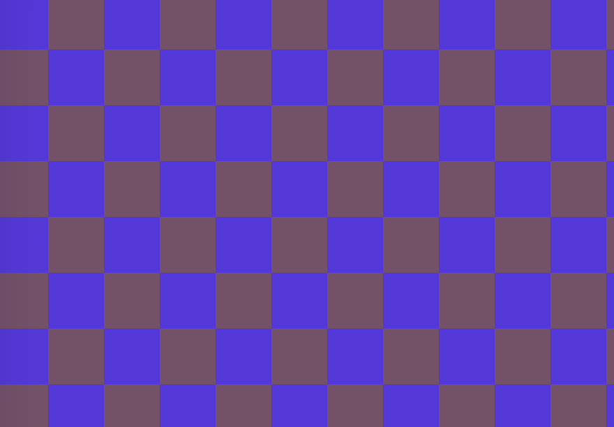
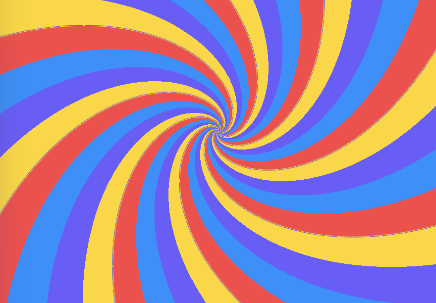
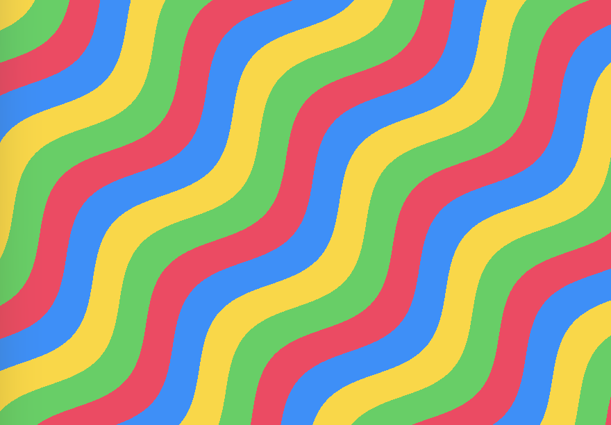
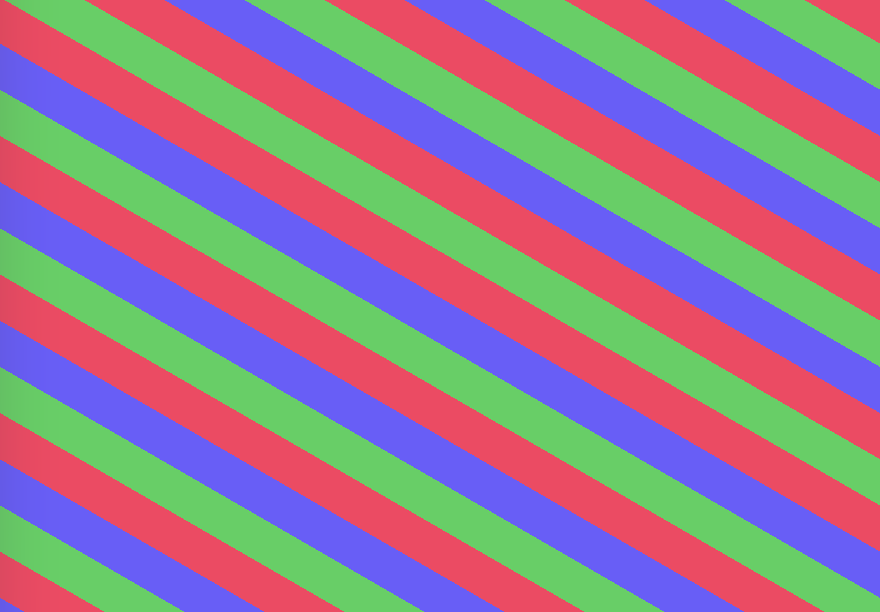
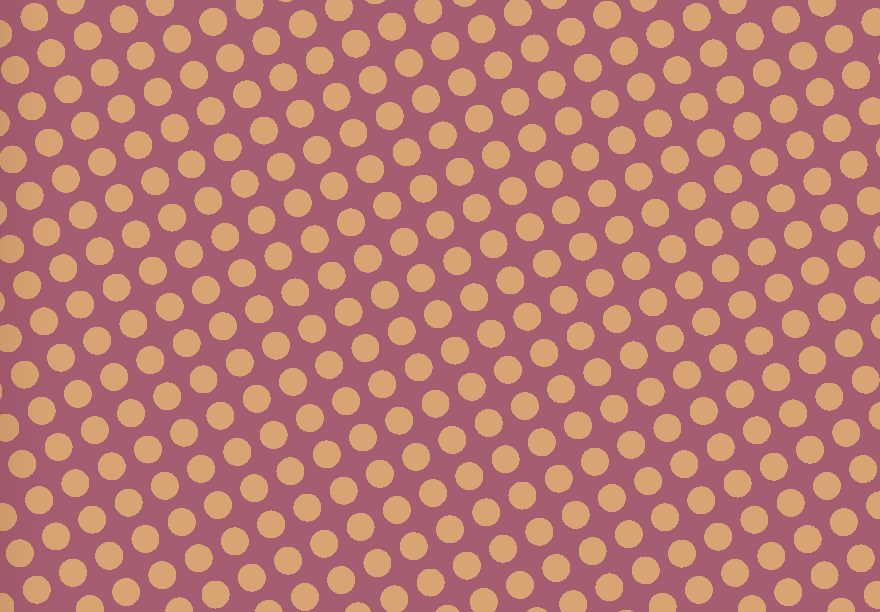
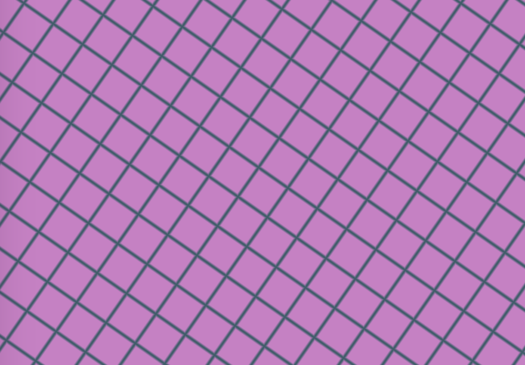
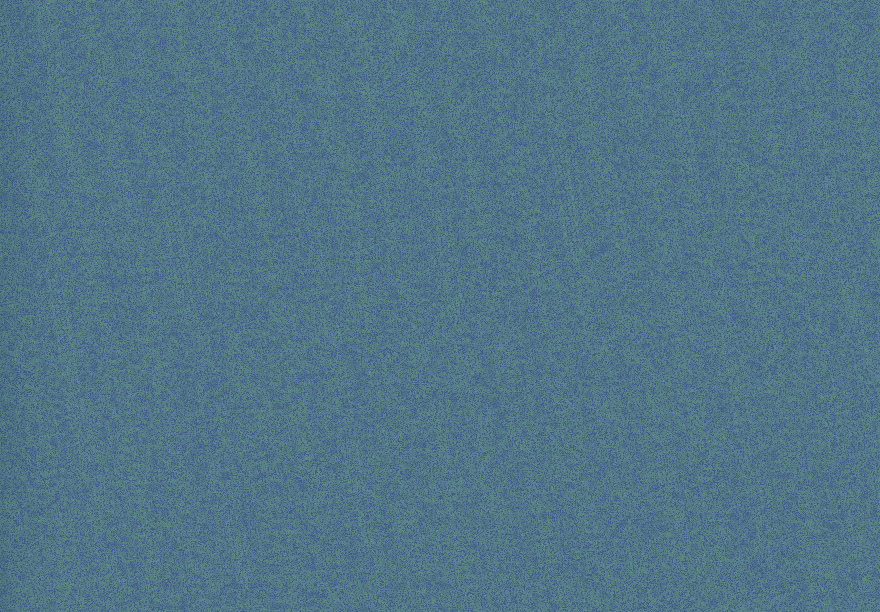

# ShadyGround


A Swift Package for Beautiful Metal Shader patterns in SwiftUI

ShadyGround provides a collection of high-performance Metal patterns for SwiftUI, with a consistent API and built-in preview capabilities. Perfect for creating stunning backgrounds and visual effects in your iOS and macOS apps.

## Installation

### Swift Package Manager

Add ShadyGround to your project using Swift Package Manager:

```swift
dependencies: [
    .package(url: "https://github.com/mikebedar/ShadyGround.git", from: "1.0.0")
]
```

## Quick Start

```swift
import ShadyGround

struct ContentView: View {
    var body: some View {
        VStack(spacing: 20) {
            // Simple checkerboard pattern
            CheckerboardBackground(
                cellSize: 16,
                backgroundColor: .blue.opacity(0.1),
                foregroundColor: .blue.opacity(0.3)
            )
            .frame(width: 200, height: 200)
            
            // Dynamic spiral with color palette
            SpiralBackground(
                stripesPerTurn: 6,
                twist: 2.0,
                colors: [.purple, .pink, .orange, .yellow, .green, .blue]
            )
            .frame(width: 200, height: 200)
            
            // Wave pattern with multiple colors
            WaveBackground(
                amplitude: 20,
                frequency: 0.1,
                stripeWidth: 25,
                colors: [.cyan, .blue, .purple, .pink]
            )
            .frame(width: 200, height: 200)
        }
    }
}
```

## Available Effects

ShadyGround includes 7 beautiful shader effects, each with customizable parameters. Three effects (Spiral, Stripe, Wave) support rich color palettes with 2-8 colors:

### Checkerboard Pattern
A classic alternating square pattern with rotation support.



```swift
CheckerboardBackground(
    cellSize: 16,           // Size of each square
    angle: .pi / 4,         // Rotation angle in radians
    backgroundColor: .blue.opacity(0.3),
    foregroundColor: .purple.opacity(0.1)
)
```

### Spiral Pattern
Dynamic spiral stripes with customizable twist and color palette. Supports 2-8 colors for stunning visual effects.



```swift
SpiralBackground(
    stripesPerTurn: 8.0,    // Number of color bands per rotation
    twist: 1.0,             // Logarithmic spiral twist factor
    centerOffsetPx: .zero,  // Offset from center in pixels
    colors: [.red, .orange, .yellow, .green, .blue, .purple]  // 2-8 colors
)
```

### Wave Pattern
Smooth wave-like stripes with amplitude and frequency control. Supports 2-8 colors for rich, dynamic patterns.



```swift
WaveBackground(
    amplitude: 20,          // Height of wave peaks
    frequency: 0.1,         // How many waves across the pattern
    stripeWidth: 25,        // Width of wave stripes
    phase: 0,               // Wave offset
    angle: 0,               // Rotation angle in radians
    colors: [.blue, .cyan, .purple, .pink]  // 2-8 colors
)
```

### Diagonal Stripes
Clean diagonal stripes with customizable width and angle. Supports 2-8 colors for vibrant patterns.



```swift
StripeBackground(
    stripeWidth: 20,        // Width of each stripe
    angle: .pi / 4,         // Rotation angle in radians
    colors: [.green, .orange, .yellow, .red]  // 2-8 colors
)
```

### Polka Dots
Circular dots arranged in a grid pattern.



```swift
DotsBackground(
    dotSize: 8,             // Diameter of each dot
    spacing: 20,            // Distance between dot centers
    angle: 0,               // Rotation angle in radians
    backgroundColor: .white.opacity(0.1),
    foregroundColor: .red.opacity(0.3)
)
```

### Grid Pattern
Clean grid lines with customizable spacing and line width.



```swift
GridBackground(
    spacing: 20,            // Distance between grid lines
    lineWidth: 1,           // Thickness of grid lines
    angle: 0,               // Rotation angle in radians
    backgroundColor: .clear,
    foregroundColor: .gray.opacity(0.2)
)
```

### Noise Pattern
TV-static style noise with fractal properties and customizable intensity.



```swift
NoiseBackground(
    scale: 1.0,             // Overall noise scale
    intensity: 1.0,         // Noise visibility (0-1)
    octaves: 4,             // Number of noise layers
    persistence: 0.5,       // How much each octave contributes
    seed: 0,                // Random seed for variation
    angle: 0,               // Rotation angle in radians
    backgroundColor: .clear,
    foregroundColor: .gray.opacity(0.8)
)
```

### Grass

Realistic turf driven by a four-channel control map you draw with ordinary SwiftUI views, rendered straight down or through a perspective camera. Red and green encode blade lean (mow direction), blue is blade height, and alpha is coverage, so low coverage reveals textured dirt. Mow stripes, checkerboards, crosshatches (two passes at any angle, as on a major-league outfield) and rings are just lean patterns; wear a path with `.grassWear()`.

```swift
// Top-down lawn with a worn path
GrassView(style: .lawn) {
    ZStack {
        GrassStripes(angle: .degrees(-90), stripeWidth: 44)
        Capsule().frame(width: 60, height: 300).grassWear(0.7)
    }
}

// A ballpark seen from the infield, in feet
GrassView(
    style: .nightGame,
    camera: .framing(eye: [0, 4, 3.2], horizonAt: 0.42, fieldOfView: .degrees(62)),
    ground: .feet(pointsPerFoot: 2, origin: UnitPoint(x: 0.5, y: 0.9)),
    atmosphere: .haze(distance: 200)
) {
    BallparkControl()
}
```

`GrassGround` says how the control map maps onto the ground (units, points per unit, where the origin sits) and is published to the map through the `grassGround` environment value so maps can draw in feet or metres. `GrassCamera` positions the eye in those units; `.framing(horizonAt:)` puts the horizon at a fraction of the view height, `.lookAt` aims at a point, and `.topDown` is the orthographic default. `GrassAtmosphere` adds fog, distance desaturation and a horizon glow. Pixels above the horizon are transparent so a backdrop can sit behind the view.

`GrassTurfSimulation` is a spring-damper grid that writes lean and height into the map: `press` it with a footstep or `roll` a ball across it every frame, draw it with `GrassSimulationControl`, and the turf is combed flat along the path and slowly springs back. `GrassCamera.groundPoint(at:in:ground:)` converts a touch location to a ground point so taps can press the lawn.

`GrassMetalView` draws the same turf entirely in Metal: the shared turf shader (`GrassCore.h`) runs as a full-screen ground pass and instanced blade geometry is drawn over the near field in the same render pass. Its map comes from a `GrassControlSource`: an image, a SwiftUI view rendered once, or a live `GrassTurfSimulation` uploaded straight to the control texture. A parity test confirms the ground pass matches `GrassView` pixel for pixel.

`GrassHybridView` stacks real blade geometry over the fragment shader: `GrassInstancedView` (an `MTKView` drawing hundreds of thousands of instanced Bezier blades from the same control map) covers the first `bladeRange` ground units and fades into the shader's far field. It is the most realistic option for low cameras, at the cost of a second renderer and a GPU budget that needs a compute cull before it is phone-ready.

Close to the camera, blades are drawn individually from a procedural height field; further away the turf is a band-limited anisotropic texture with a view-dependent stripe model. Presets: `.lawn`, `.ballpark`, `.stadium` (sunlit turf seen from the stands, tuned against upper-deck and drone photographs), `.nightGame`, `.golfGreen`, `.meadow`, `.dry`, `.artificial`. `GrassControl.heightMap(from:)` turns any image into a control map so a logo can be mown into the outfield. Set `windStrength` on a `GrassStyle` to animate a breeze. A pre-authored image works too: `GrassView(style: .lawn, controlMap: Image("field-control"))`.

## Metal Surfaces

Effects that need their own render passes build on `Core/MetalSurface.swift`: conform a renderer to `MetalSurfaceRenderer` (pipelines, formats, one `encode` per frame), host it with `MetalSurfaceView`, render it offscreen in tests with `MetalOffscreenTarget`, load functions through `ShadyGroundMetalLibrary`, and upload images with `MetalImageTexture`. `GrassMetalRenderer` is the first renderer built this way.

### Metal materials

`MetalMaterialSurface` draws a metal with `MetalMaterialRenderer`: a height field per `MetalFinish` (`.polished`, `.brushed`, `.satin`, `.patina`) gives the normals, Cook-Torrance GGX the highlight from a point light above the surface, and a ceiling/floor gradient the reflection. Presets: `.brushedAluminum`, `.polishedSteel`, `.anodizedAluminum`, `.copperPatina`, `.titanium`, `.gold`, `.silver` (`MetalMaterial.presets`), or build your own `MetalMaterial(baseColor:roughness:metallic:finish:)`.

```swift
MetalMaterialSurface(.gold, lightDirection: [-0.3, 0.5, 0.8], isAnimating: !reduceMotion)
    .frame(height: 200)
    .clipShape(.rect(cornerRadius: 16))
```

It is decorative: hidden from accessibility, no hit testing. It draws once and redraws only when an input changes; `isAnimating` (ignored under Reduce Motion) sways the light at 30 fps. Drive `lightDirection` to follow a pointer or the device's tilt; the surface reads no sensors itself.

## Time-Based Animation
Example of an animated use case with `AnimatedSpiralBackground`:

```swift
// Automatically animates the spiral twist over time
AnimatedSpiralBackground(
    stripesPerTurn: 8,
    baseTwist: 1.0,
    twistAmplitude: 2000.0,
    animationSpeed: 0.25,
    colors: [.red, .orange, .yellow, .green, .blue, .purple]
)
```

## Requirements

- iOS 17.0+ / macOS 14.0+
- Swift 6.2+
- Xcode 16.0+

## License

This project is licensed under the MIT License - see the LICENSE file for details.

## Contributing

Contributions are welcome! Please feel free to submit a Pull Request.

## Support

If you encounter any issues or have questions, please open an issue on GitHub.
